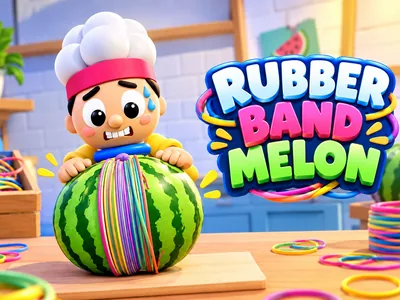
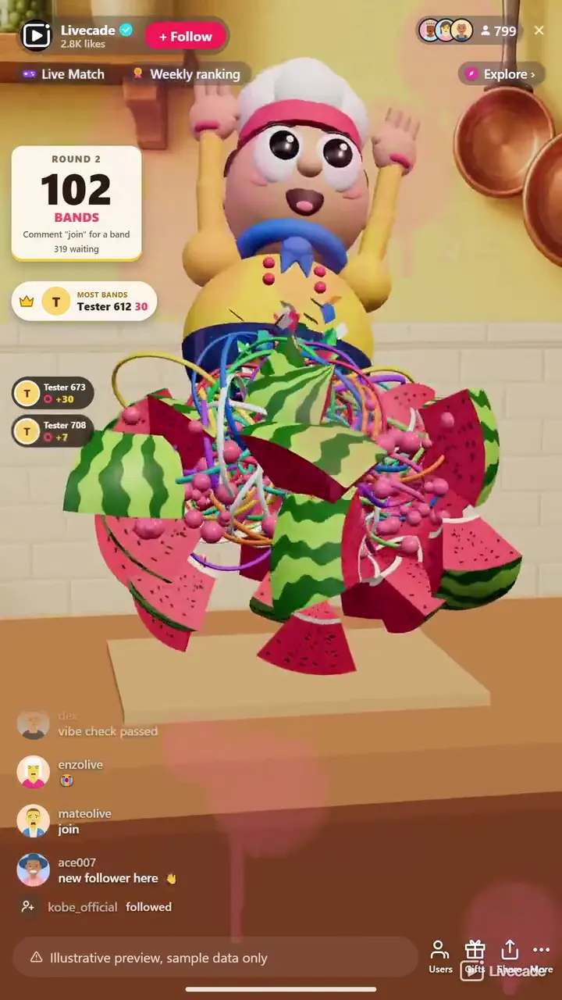

# Rubber Band Melon - Interactive TikTok Live Game

> Rubber bands on a giant melon until it pops. Whose band will burst it?

Viewers wrap rubber bands around a giant melon on your stream until it pops at a secret strength, and the viewer whose band pops it fills the screen. Gifts bring thick bands, scissors and a giant hammer.

**[Play Rubber Band Melon on Livecade](https://livecade.io/games/rubber-band-melon/?utm_source=github&utm_medium=readme&utm_campaign=rubber-band-melon)** - runs as a single browser source in OBS, Streamlabs, or TikTok LIVE Studio. Nothing for viewers to install.

## How viewers play

Viewers take part with the actions TikTok already gives them: **comments**, **follows**, **gifts**, **likes**, **shares**. Every action below is rebindable, so you decide which interaction drives which effect.

| Action | What it does |
| --- | --- |
| **Band** | One coloured band on the melon. From a gift it goes on ahead of the free bands |
| **Join** | One free band, once per viewer per melon |
| **Thick band** | One fat red band, worth ten bands of strength |
| **Band rain** | 25 bands fly onto the melon in a quick rain |
| **Take off** | The chef pulls the last five bands back off, one at a time |
| **Scissors** | Giant scissors cut the last ten bands off |
| **Hammer** | A giant hammer with the sender's face smashes the melon whatever its strength, and the sender is the popper |

## How it works

### One band each

A follow, a "join" comment or a Rose puts a coloured band on the melon. "Join" gives each viewer one free band per melon.

### A secret strength

Every melon pops at a different number of bands that nobody knows. The pinch, the cracks, the juice and the chef's face show how close it is.

### Push it or save it

Gifts add thick bands, band rain or the hammer to pop it sooner, or have the chef take bands off and the scissors cut them to keep it going.

### Speeds up when busy

The chef puts a band on in under a second at normal speed and hurries by himself when many gift bands are waiting. Every band still goes on.

## About the game

Rubber Band Melon puts a big watermelon on a cutting board in 3D, with a chubby chef behind it. Every viewer who follows, comments "join" or sends a Rose gets a coloured rubber band, and the chef stretches it over the end of the melon and drags it to the middle. As the bands pile up the melon pinches into an hourglass, creaks, cracks and leaks juice, and the chef starts to sweat and then to tremble. Every melon has a secret strength. The band that takes it past its limit pops it in slow motion into 24 pieces, with bands flying everywhere, and the popper's face and name fill the screen.

### Gifts push and pull

Out of the box a Rose or a TikTok adds one band and a Finger Heart five. A Perfume puts on one fat red band worth ten, a Hand Heart rains 25 bands onto the melon, and a Money Gun brings a giant hammer with the sender's face on it that rises over the melon and smashes it in one hit, whatever its strength. The other side can fight back: a Rosa has the chef pull the last five bands back off one by one, and a Doughnut's giant scissors cut the last ten. A Galaxy brings the same hammer.

### Crown and gold bands

The viewer with the most bands on the melon wears the crown. A viewer who adds five bands within 20 seconds gets a gold sixth band worth three. Gift bands still waiting when a melon pops go onto the next one, so no gift is lost.

### Made for TikTok Live

Safe mode is on by default: a softer pop with light pink juice that fades quickly, so TikTok does not mistake it for something violent. The last popper's photo hangs on the wall until the next pop, and a saved score board lets you show the top poppers of today, the week or all time from the host controls.

### Every gift adds bands

A gift with no trigger of its own still adds bands by its value: one band per TikTok coin, up to 100 from one gift. Turn that setting off and only the gifts you bound add bands.

## What it looks like on stream

[Watch Rubber Band Melon gameplay](https://cdn.livecade.io/games/rubber-band-melon.mp4)

## What you can configure

- **Language** - Thirteen languages for the counter, the winner card and the trigger labels
- **Melon strength** - Six ranges from Short (40 to 90 bands) to Massive (1,000 to 1,500). Short is the default, so smaller streams still see pops, and the long ones keep a melon going on a busy live
- **Melon size** - Normal, big or giant. It only changes the look, never how many bands it takes
- **Band speed** - Slow, normal or fast. The chef also hurries by himself when many gift bands are waiting
- **Fruit** - Watermelon, pumpkin, cantaloupe, or a different one each round
- **Gold bands** - A gold sixth band for five bands in 20 seconds, on or off
- **Camera** - Fixed, light, or dynamic: it turns slowly around the melon and moves in as it gets close to popping
- **Effects and safe mode** - Slow motion pop, juice on the screen and camera shake, each on or off. Safe mode keeps the pop soft and the juice light pink
- **Scene** - A kitchen, a picnic table or a fruit market stall, or Custom: your own colour, a transparent background, or an image

## Languages

English, Spanish, Portuguese, French, German, Italian, Indonesian, Arabic, Turkish, Russian, Hindi, Romanian, Filipino

## FAQ

<strong>How do viewers play Rubber Band Melon?</strong>

Out of the box a follow, the comment "join" or a Rose puts a band on the melon. Every trigger can be rebound, so likes, shares or any gift can add bands instead.

<strong>How many bands does it take to pop the melon?</strong>

Nobody knows. Every melon has its own secret strength, by default between 40 and 90 bands, and up to 1,500 on the longest setting. Only you can see it, in the host controls.

<strong>Can viewers save the melon?</strong>

Yes. By default a Rosa has the chef take five bands off and a Doughnut's scissors cut the last ten, so your chat can fight over when it pops.

<strong>Is the pop safe for TikTok?</strong>

Safe mode is on by default: the pop is softer, the juice is light pink and fades quickly, and nothing gory lingers on screen.

<strong>Will Rubber Band Melon run on my PC?</strong>

It renders in 3D on the computer running your stream, so give it a reasonably modern machine. Try it in the dashboard preview before you go live.

<strong>How do I add Rubber Band Melon to my TikTok Live?</strong>

Add one browser source URL to OBS or your streaming software and go live. There is no plugin to install and nothing for your viewers to download.

## Setup

1. [Create a Livecade account](https://app.livecade.io/register?utm_source=github&utm_medium=cta&utm_campaign=rubber-band-melon)
2. Copy your overlay browser source URL
3. Paste it into OBS, Streamlabs, or TikTok LIVE Studio
4. Pick Rubber Band Melon, set your triggers, and go live

Runs in the browser, so it works on Windows and macOS with nothing to download. [See all TikTok Live games](https://livecade.io/tiktok-live-games/?utm_source=github&utm_medium=readme&utm_campaign=rubber-band-melon).

---

_This repository documents Rubber Band Melon, a hosted interactive game by [Livecade](https://livecade.io/?utm_source=github&utm_medium=footer&utm_campaign=rubber-band-melon). The game runs on Livecade's platform, so there is no source to install here._
